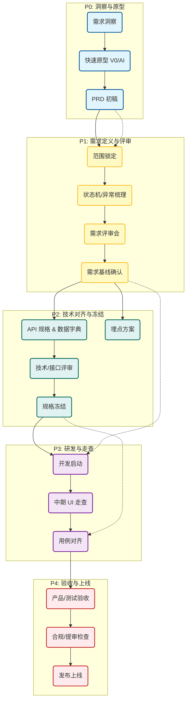

# 产品经理标准化工作流 SOP (Standard Operating Procedure)

> **适用场景**：从 0 到 1 新项目或复杂迭代  
> **使用方法**：每个阶段开始时对照“核心任务”，结束时检查“交付物”是否齐备。

---

## 1. 全流程概览图

---

## 2. 分阶段检查清单 (Checklist)

### 阶段 P0：洞察与原型 (Insight & Prototype)
> **目标**：快速把脑子里的想法具象化，不求细节完美，但求方向对了。

- [ ] **核心价值明确**：一句话说清“谁在什么场景下解决什么问题”。
- [ ] **原型产出**：使用 V0 / 墨刀 AI / 手绘 产出低保真页面。
  - [ ] 覆盖核心路径（从入口到终点）。
  - [ ] 包含 3-5 个关键页面（首页、列表、详情、结果）。
- [ ] **PRD 骨架**：
  - [ ] 核心功能模块清单。
  - [ ] 关键流程图（业务流）。

---

### 阶段 P1：需求定义与评审 (Requirement Definition)
> **目标**：明确“做什么”和“不做什么”，补充边界逻辑，达成业务共识。

- [ ] **范围锁定 (Scope Lock)**
  - [ ] 本期必须上线的 P0 功能有哪些？
  - [ ] 哪些功能明确移到 v1.1（Out of Scope）？
- [ ] **深度逻辑梳理 (The "Hidden" Parts)**
  - [ ] **权限**：哪些页面必须登录？拒绝授权怎么办？
  - [ ] **状态**：加载中、空数据、网络错误、操作失败怎么展示？
  - [ ] **规则**：排序逻辑、筛选逻辑、推荐逻辑是什么？
- [ ] **需求评审会 (Requirement Review)**
  - [ ] **参与人**：前端、后端、测试、UI。
  - [ ] **动作**：讲一遍完整用户故事；确认是否有技术难点或高成本点。
  - [ ] **产出**：需求基线（各方确认过的 PRD）。

---

### 阶段 P2：技术对齐与规格冻结 (Tech Alignment)
> **目标**：把业务需求翻译成技术语言，确保前后端、数据、测试理解一致。

- [ ] **接口与数据对齐 (API & Data)**
  - [ ] **API_SPEC**：接口列表、分页方式、鉴权、错误码已确认。
  - [ ] **数据字典**：字段含义、枚举值、单位、精度已冻结。
  - [ ] **三方服务**：地图/支付/短信的接入方式（代理还是直连）已定。
- [ ] **埋点方案 (Tracking)**
  - [ ] 核心指标（北极星指标）已定义。
  - [ ] 事件表（Event/Props）已输出并与开发对齐。
- [ ] **技术评审会 (Tech Review)**
  - [ ] **参与人**：前后端负责人、测试。
  - [ ] **决策**：认可 API 结构、同意埋点方案、确认排期。

---

### 阶段 P3：研发推进与走查 (Development & Check)
> **目标**：在开发过程中保持关注，避免“做偏了”或“最后才发现有问题”。

- [ ] **迭代启动**
  - [ ] Jira/任务板已拆解（Story 描述清晰）。
  - [ ] 开发已拿到 UI 设计稿与切图。
- [ ] **中期走查 (Spot Check)**
  - [ ] **时间点**：开发进行到 50% 或核心接口联调通了时。
  - [ ] **动作**：让前端在开发环境演示核心路径（登录->列表->详情）。
  - [ ] **检查点**：
    - [ ] 状态机逻辑（Loading/空/错）是否实现了？
    - [ ] 异常流程（取消/拒绝）有没有漏？
- [ ] **验收准备**
  - [ ] **验收用例 (Acceptance Cases)**：输出 `ACCEPTANCE_TESTCASES.md` 给测试。
  - [ ] **数据准备**：确认测试环境有覆盖各种状态（长短文案、多种状态）的数据。

---

### 阶段 P4：验收与上线 (UAT & Launch)
> **目标**：守门员。确保交付物质量符合预期，合规安全，顺利发布。

- [ ] **产品验收 (UAT)**
  - [ ] 对照验收用例执行一遍核心流程。
  - [ ] 验证边界场景（断网、Token 过期、权限拒绝）。
  - [ ] 验证埋点数据（抓包看事件触发）。
- [ ] **合规与提审检查**
  - [ ] `MP_COMPLIANCE` 内容已落实（隐私弹窗文案、权限用途）。
  - [ ] 提审材料（截图、账号、隐私协议）已准备。
- [ ] **发布准备**
  - [ ] 上线配置（开关、运营位、文案）已配置到生产环境。
  - [ ] 灰度策略已定（全量发布还是分比例）。
- [ ] **上线后验证**
  - [ ] 生产环境冒烟测试。
  - [ ] 观察实时数据/日志是否有异常。

---

## 3. 关键自问清单 (Self-Check Questions)

在任何时候犹豫要不要找人沟通时，问自己：

1. **“这个逻辑如果不定义，开发会怎么做？”**
   - 如果答案是“随机做”或“按最简单的做”，那你必须定义。
2. **“这个异常如果发生了，用户会被卡死吗？”**
   - 如果会，必须定义降级或引导策略。
3. **“这个数据如果没埋点，上线后我能回答老板/客户的问题吗？”**
   - 如果不能，必须补埋点。
4. **“这个字段前后端理解一致吗？”**
   - （如：金额是分还是元？时间是时间戳还是字符串？）如果不确定，必须写进数据字典。
